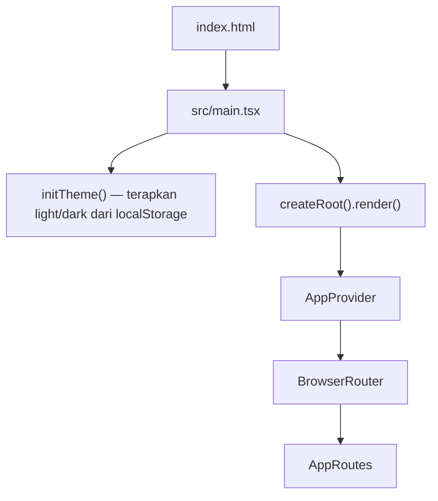
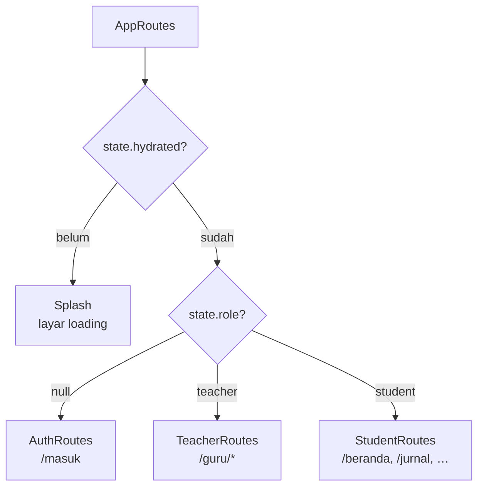
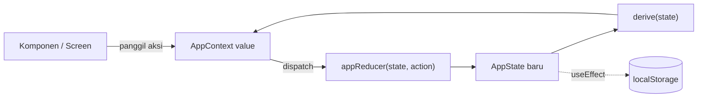
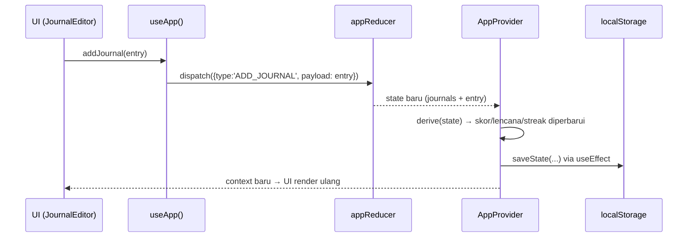

# Arsitektur

Dokumen ini menjelaskan bagaimana aplikasi disusun: stack, struktur folder,
routing, manajemen state, alur data, dan persistensi. Aplikasi ini adalah
**frontend-only** (mock) — tidak ada backend; semua data disimpan di
`localStorage` browser.

## 1. Stack

| Kategori | Pilihan | Versi |
| --- | --- | --- |
| UI library | React | 19.2 |
| Bundler + dev server | Vite | 8.3 |
| Bahasa | TypeScript (strict) | ~6.0 |
| Styling | Tailwind CSS (via `@tailwindcss/vite`) | 4.3 |
| Routing | react-router-dom | 7.18 |
| Ikon | `@phosphor-icons/react` | 2.1 |
| Grafik | `recharts` | 3.10 |
| Utilitas kelas | `clsx` (via `src/lib/cn.ts`) | 2.1 |
| Font | Plus Jakarta Sans (variabel), IBM Plex Mono | 5.3 |
| Linter | `oxlint` | 1.81 |

Script (lihat `package.json`):

```bash
npm run dev      # vite — dev server + HMR
npm run build    # tsc -b && vite build — typecheck lalu bundel produksi
npm run lint     # oxlint
npm run preview  # pratinjau hasil build
```

## 2. Struktur Folder

```
src/
├── main.tsx            # Entry: initTheme() + <App/> di dalam StrictMode
├── App.tsx             # Root: AppProvider + BrowserRouter + gating role
├── index.css           # Token desain, base layer, utilitas, keyframes motion
├── types/              # Semua tipe domain (index.ts)
├── config/             # Data konfigurasi statis
│   ├── dimensions.ts   #   6 dimensi PPP + 6 dimensi Kesiapan Kerja
│   ├── majors.ts       #   Konfigurasi jurusan + daftar kelas
    │   ├── badges.ts       #   Definisi lencana
    │   ├── tour.ts         #   Copy tur guide per role
    │   └── teacherRoles.ts #   Label/meta role guru + label & target risiko
├── data/               # Data seed (mock) yang dimuat ke state
│   ├── students.ts     #   12 murid (4 per jurusan)
│   ├── teachers.ts     #   5 akun guru
│   ├── journals.ts     #   Jurnal
│   ├── targets.ts      #   Target
│   └── chats.ts        #   Sesi konsultasi (termasuk contoh alert risiko)
├── lib/                # Logika murni (tanpa React)
│   ├── scoring.ts      #   Skor dimensi, streak, lencana
│   ├── risk.ts         #   Deteksi & eskalasi risiko
│   ├── ai.ts           #   Generator balasan AI (rule-based)
│   ├── teacher.ts      #   Selector khusus guru (roster, review, alert, stats)
    │   ├── storage.ts      #   Persistensi localStorage
    │   ├── tour.ts         #   Status tur guide per role (localStorage)
    │   ├── format.ts       #   Format tanggal, mood, greeting, clamp
    │   ├── settings.ts     #   Preferensi tampilan & aksesibilitas (per perangkat)
    │   ├── theme.ts        #   Light/dark/system
    │   ├── teacherSettings.ts # Preferensi tampilan guru (per teacherId)
    │   └── cn.ts           #   Penggabung className (clsx)
├── store/              # State global
│   ├── appState.ts     #   AppState, reducer, selector `derive()`
│   ├── AppContext.ts   #   Context + hook `useApp()`
│   └── AppProvider.tsx #   Provider: hydrate, persist, aksi
├── routes/             # Pohon rute per grup
│   ├── AuthRoutes.tsx  #   /masuk
│   ├── StudentRoutes.tsx
│   └── TeacherRoutes.tsx
├── screens/            # Halaman (per domain/role)
│   ├── auth/           #   LoginScreen
│   ├── student/        #   Home, Journal, Consult, Progress, Resume, Pkl, Profile, Onboarding
│   └── teacher/        #   Dashboard, ReviewResume, RiskAlerts, Students, Pkl, Settings
└── components/         # Komponen yang dapat dipakai ulang
    ├── ui/             #   Primitif desain (Button, Card, Chip, Field, Sheet, …)
    ├── layout/         #   AppShell, TeacherShell, Sidebar, TabBar, TopBar, Splash
    ├── charts/         #   GrowthRadar, GrowthBloom, DimensionBars
    ├── chat/           #   Composer, MessageBubble, RiskNotice
    ├── journal/        #   JournalCard, MoodPicker, DimensionTagPicker
    ├── progress/       #   BadgeGrid, TargetSection
    ├── resume/           #   WeekTimeline, WeekDetailBody
    ├── settings/         #   Bagian pengaturan (DisplaySection, AccessibilitySection, …)
    ├── teacher/          #   TeacherSidebar, StatTile, StudentRow, RiskAlertCard, …
    └── tour/             #   TourProvider, Spotlight, TourCard, useTargetRect
```

Prinsip pemisahan:

- **`lib/`** berisi logika murni yang bisa diuji tanpa React. Ini tempat rumus
  skor, deteksi risiko, dan selector guru.
- **`config/` vs `data/`**: `config/` = konfigurasi relatif tetap (dimensi,
  jurusan, lencana). `data/` = data isi yang bisa berubah (murid, jurnal, chat).
- **`screens/`** adalah halaman ber-`route`; **`components/`** adalah bagian yang
  dipakai ulang. Halaman tipis, komponen mengurus tampilan.

## 3. Bootstrap Aplikasi

Urutan dari HTML sampai layar pertama:



`AppProvider` membuat state global, memuat data tersimpan, dan menyediakan
context ke seluruh pohon. `BrowserRouter` menangani navigasi berbasis URL.

## 4. Routing & Gating Role

`App.tsx` memilih pohon rute berdasarkan state:



- **`AuthRoutes`** — satu rute `/masuk`; semua URL lain dialihkan ke sana.
- **`StudentRoutes`** — jika `state.onboarded` masih `false`, hanya
  `/onboarding` yang aktif. Jika sudah, rute utama berada di dalam `AppShell`
  (layout dengan sidebar/tab bar).
- **`TeacherRoutes`** — rute di dalam `TeacherShell`, semua di bawah `/guru`.

Halaman murid dan guru dimuat secara **lazy** (`React.lazy` + `<Suspense>`),
dengan `Splash` sebagai fallback. `OnboardingScreen` dan layout
(`ConsultLayout`, `JournalLayout`) diimpor langsung karena dibutuhkan segera.

Peta rute lengkap ada di [`roles-and-routing.md`](roles-and-routing.md).

## 5. Manajemen State

State global memakai `useReducer` di `src/store/appState.ts` dengan satu union
aksi (`AppAction`).



- **`AppState`** memuat `role`, `onboarded`, penunjuk murid/guru aktif, dan
  koleksi `students`, `teachers`, `journals`, `targets`, `chats`.
- **Reducer** menangani `HYDRATE`, `LOGIN`, `LOGOUT`, `COMPLETE_ONBOARDING`,
  `ENTER_DEMO`, `SET_STUDENT`, operasi jurnal/target/chat, dan `RESET`.
- **`derive(state)`** menghitung nilai turunan sekali per perubahan state:
  murid & guru aktif, skor dimensi (PPP + Kesiapan Kerja), rata-rata, lencana,
  streak, dan jumlah jurnal. Hasilnya digabung ke context agar UI tidak
  menghitung ulang.
- **`AppProvider`** menyusun `AppContextValue`, yang berisi `state`, nilai
  turunan, dan fungsi aksi (mis. `loginAsTeacher`, `addJournal`, `startChat`).

Komponen mengonsumsi semuanya lewat hook:

```ts
import { useApp } from '../store/AppContext'

const { state, currentStudent, characterScores, addJournal } = useApp()
```

`currentStudent` adalah murid aktif; `currentTeacher` adalah guru aktif (dipakai
modul guru).

## 6. Alur Data: dari Aksi ke Tampilan

Contoh menambah jurnal:



Pola yang sama berlaku untuk target, sesi konsultasi, dan pesan chat. Balasan
AI dihasilkan oleh `lib/ai.ts` (sinkron) di dalam `AppProvider`, lalu ditambahkan
sebagai pesan AI dengan opsi `risk` bila terdeteksi.

## 7. Persistensi

`src/lib/storage.ts` menyimpan state ke `localStorage`:

- **Kunci state:** `ruang-tumbuh:state:v1`
- **Kunci tema:** `ruang-tumbuh:theme`
- **Kunci pengaturan (a11y/display):** `ruang-tumbuh:settings:v1`
- **Kunci pengaturan guru:** `ruang-tumbuh:teacher-settings:v1` (peta per `teacherId`)

Alur:

1. Saat mount, `AppProvider` memanggil `loadState()` lalu `dispatch(HYDRATE)`.
2. Setiap perubahan state setelah `hydrated`, `saveState(state)` dipanggil.
3. `RESET` memanggil `clearState()` dan mengembalikan state awal.

`resetDemo()` (aksi "Reset data demo") juga mengembalikan **preferensi** ke
bawaan: `resetSettings()`, `resetTheme()`, dan `resetAllTeacherPrefs()`.

Untuk **kompatibilitas ke belakang**, `loadState()` mengisi nilai default yang
hilang — mis. `role` lama yang belum tersimpan dianggap `'student'`. Bidang
`teachers`/`currentTeacherId` opsional agar state versi lama tetap terbaca.

Skema `PersistedState` selengkapnya ada di [`data-model.md`](data-model.md).

## 8. Tema

`src/lib/theme.ts` mengelola preferensi `system | light | dark`. `initTheme()`
dipanggil di `main.tsx` sebelum render. Mode gelap diterapkan dengan menambahkan
kelas `dark` pada `<html>`; token warna berganti otomatis lewat CSS variables
(lihat [`design-system.md`](design-system.md)).

## 9. Preferensi & aksesibilitas

Tiga store terpisah, semuanya berbasis `useSyncExternalStore` agar perubahan
langsung terasa di seluruh aplikasi:

| Store | Berkas | Cakupan | Dipakai oleh |
| --- | --- | --- | --- |
| `SettingsState` | `src/lib/settings.ts` | Per perangkat | Murid & guru (tema, skala teks, buta warna, a11y) |
| `ThemePreference` | `src/lib/theme.ts` | Per perangkat | Murid & guru |
| `TeacherPrefs` | `src/lib/teacherSettings.ts` | Per `teacherId` | Layar guru saja |

`applySettings()` menoggle kelas pada `<html>` (`contrast-tinggi`, `mode-baca`,
`spasi-lega`, `teks-tebal`, `garis-bawah-tautan`, `kurangi-transparansi`).
Aturan CSS-nya ada di blok **unlayered** `src/index.css` agar menimpa layer
`@theme` Tailwind (lihat [`design-system.md`](design-system.md) §8).

Preferensi guru dibaca lewat `useTeacherPrefs(teacherId)`; efek samping tampilan
(anonimasi nama, kerapatan tabel, avatar, lencana notifikasi) diterapkan di
layar dan komponen guru melalui `useStudentNaming()`.

## 10. Batasan

- **Tanpa backend**: semua data mock, tidak ada sinkronisasi multi-perangkat.
- **Generator AI rule-based** (kata kunci + template), bukan model bahasa.
- **Export PDF resume** masih berupa mock.
- Deteksi risiko berbasis kata kunci, sehingga bisa salah deteksi; sifatnya
  sebagai alat bantu, bukan penentu tunggal.
- Preferensi aksesibilitas tersimpan per perangkat (localStorage), tidak
  tersinkron antar akun maupun perangkat.
- "Mode anonim" hanya menutupi nama di tampilan peramban; data asli tetap ada
  di penyimpanan lokal.
