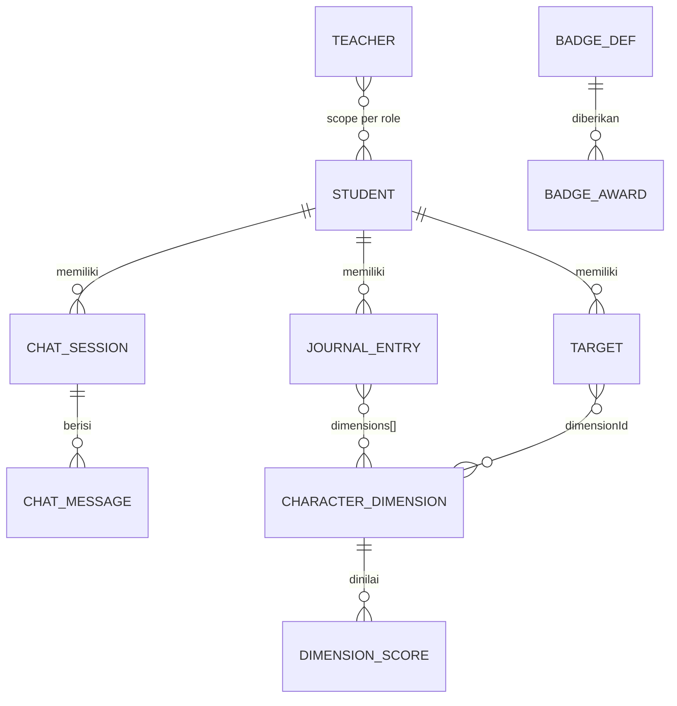

# Model Data

Semua tipe domain berada di [`src/types/index.ts`](../src/types/index.ts).
Dokumen ini merangkum field, relasi, data seed, dan skema persistensi.

## 1. Diagram Relasi



## 2. Tipe Inti

### Identitas & klasifikasi

```ts
type Major = 'PERHOTELAN' | 'AKUNTANSI' | 'PPLG'
type Grade = 'X' | 'XI' | 'XII'
type PklStatus = 'belum' | 'sedang' | 'selesai'
type UserRole = 'student' | 'teacher'
type TeacherRole =
  | 'WALI_KELAS' | 'GURU_BK' | 'PEMBIMBING_PKL' | 'KAPROG' | 'ADMIN'
type DimensionGroup = 'PPP' | 'WORK_READINESS'
type ChatMode = 'REFLEKSI' | 'BELAJAR' | 'SOSIAL' | 'KARIER' | 'PKL'
type MoodLevel = 'sangat-baik' | 'baik' | 'biasa' | 'kurang' | 'berat'
type RiskSeverity = 'sedang' | 'tinggi'
```

### `Student`

| Field | Tipe | Catatan |
| --- | --- | --- |
| `id` | `string` | Murid onboarding memakai id khusus `'me'` |
| `name` | `string` | |
| `major` | `Major` | |
| `grade` | `Grade` | |
| `pklStatus` | `PklStatus` | |
| `pklPlacement?` | `string` | Nama tempat PKL (opsional) |
| `initials` | `string` | Inisial untuk avatar |
| `joinedAt` | `string` | ISO date |

### `Teacher`

| Field | Tipe | Catatan |
| --- | --- | --- |
| `id` | `string` | |
| `name` | `string` | |
| `initials` | `string` | |
| `role` | `TeacherRole` | Menentukan cakupan data |
| `title` | `string` | Jabatan tampil di UI |
| `major?` | `Major` | Untuk role yang terikat jurusan |
| `grade?` | `Grade` | Untuk wali kelas |
| `homeroom?` | `string` | Nama kelas binaan |
| `email` | `string` | |

### `JournalEntry`

| Field | Tipe | Catatan |
| --- | --- | --- |
| `id` | `string` | |
| `studentId` | `string` | Relasi ke `Student` |
| `date` | `string` | ISO date |
| `title`, `body` | `string` | |
| `mood` | `MoodLevel` | |
| `dimensions` | `string[]` | Daftar id dimensi (PPP / WR) |
| `evidence?` | `string` | Tautan bukti |
| `prompt?` | `string` | Prompt refleksi yang memicu |
| `pkl?` | `boolean` | Ditandai saat masa PKL |
| `tags?` | `string[]` | |

### `Target`

| Field | Tipe | Catatan |
| --- | --- | --- |
| `id`, `studentId` | `string` | |
| `title`, `detail?` | `string` | |
| `due?` | `string` | ISO date (dipakai untuk target mingguan) |
| `status` | `'aktif' \| 'selesai'` | |
| `dimensionId` | `string` | Terkait satu dimensi |
| `progress` | `number` | 0–100 |

### Obrolan (chat)

`ChatSession`: `id`, `studentId`, `mode` (`ChatMode`), `title`, `messages[]`,
`startedAt`, `lastAt`, `escalated?`.

`ChatMessage`: `id`, `role` (`'user' | 'ai'`), `text`, `at`, serta opsional
`suggestion` (`AiSuggestion`), `risk` (`RiskFlag`), `escalatedTo` (`string[]`).

`AiSuggestion`: `{ kind: 'aksi' | 'jurnal' | 'sumber'; text: string }`.

### Risiko

```ts
interface RiskFlag {
  category: RiskCategory
  severity: RiskSeverity
  label: string
}
type RiskCategory =
  | 'bullying' | 'kekerasan' | 'self-harm' | 'krisis'
  | 'pkl-pelecehan' | 'pkl-eksploitasi' | 'pkl-keselamatan'
  | 'ekonomi' | 'kecanduan'
```

### Dimensi, lencana, resume

- `CharacterDimension`: `id`, `label`, `short`, `group` (`DimensionGroup`),
  `description`, `color` (CSS var).
- `DimensionScore`: `dimension`, `score`, `mentions`.
- `BadgeDef`: `id`, `name`, `description`, `major` (`Major | 'UMUM'`),
  `dimensionId?`, `kind` (`konsistensi | kualitas | jurusan | pkl | karier`).
- `BadgeAward`: `badgeId`, `earnedAt`.
- `ResumeWeek`: `id`, `label`, `rangeStart`, `rangeEnd`, `entries[]`,
  `moodSummary[]`, `targetsTouched[]`, `chatCount`, `highlights[]`,
  `pklNotes?[]`, `status` (`'menunggu-review' | 'direview'`).
- `MajorConfig`: konfigurasi jurusan (`name`, `fullName`, `tagline`, `values[]`,
  `reflectionPrompts[]`, `smallActions[]`, `portfolioFocus[]`).

## 3. Konfigurasi Statis (`src/config/`)

| Berkas | Ekspor | Isi |
| --- | --- | --- |
| `dimensions.ts` | `PPP_DIMENSIONS`, `WORK_READINESS_DIMENSIONS`, `ALL_DIMENSIONS`, `DIMENSION_GROUP_LABEL`, `getDimension(id)` | 6 + 6 dimensi dengan id, label, warna |
| `majors.ts` | `MAJORS`, `MAJOR_LIST`, `GRADE_LIST` | Konfigurasi 3 jurusan + opsi kelas |
| `badges.ts` | `BADGES`, `BADGE_MAP` | 12 definisi lencana |
| `teacherRoles.ts` | `TEACHER_ROLE_META`, `TEACHER_ROLE_LIST`, `RISK_CATEGORY_LABEL`, `RISK_TARGET_ROLE` | Label/meta role guru & pemetaan risiko |

Id dimensi yang dipakai di kode:

- **PPP**: `beriman`, `berkebinekaan`, `gotong-royong`, `mandiri`,
  `bernalar-kritis`, `kreatif`
- **Kesiapan Kerja**: `disiplin`, `tanggung-jawab`, `etika-profesi`,
  `komunikasi-tim`, `inisiatif`, `adaptasi`

## 4. Data Seed (`src/data/`)

- **`students.ts`** — 12 murid, 4 per jurusan, variasi kelas X/XI/XII dan status
  PKL. `DEFAULT_STUDENT_ID = 'anisa'`; helper `getStudent()`.
- **`teachers.ts`** — 5 akun guru mewakili tiap `TeacherRole`.
  `DEFAULT_TEACHER_ID = 't-bk'` (Guru BK, cakupan semua murid); helper `getTeacher()`.
- **`journals.ts`** — jurnal contoh lintas murid/dimensi.
- **`targets.ts`** — target contoh.
- **`chats.ts`** — sesi konsultasi. Termasuk 3 sesi ber-`risk` (eksploitasi PKL,
  kecanduan gim, krisis tinggi) agar halaman alert guru terisi saat demo.
- Seed dimuat di `createInitialState()` (`src/store/appState.ts`).

## 5. Skema Persistensi

Disimpan di `localStorage` dengan kunci **`ruang-tumbuh:state:v1`**. Tipe
`PersistedState` (`src/lib/storage.ts`):

| Field | Tipe | Catatan |
| --- | --- | --- |
| `role?` | `UserRole \| null` | Default `'student'` saat hidrasi state lama |
| `onboarded` | `boolean` | |
| `currentStudentId` | `string` | |
| `currentTeacherId?` | `string` | Ditambahkan setelah fitur guru |
| `students` | `Student[]` | |
| `teachers?` | `Teacher[]` | Opsional untuk kompatibilitas |
| `journals` | `JournalEntry[]` | |
| `targets` | `Target[]` | |
| `chats` | `ChatSession[]` | |

Aturan penting:

- `loadState()` mengembalikan `null` bila `students` kosong atau
  `currentStudentId` tidak ada.
- Bidang yang hilang diisi default; lihat `HYDRATE` di `appState.ts`.
- Kunci tema terpisah: **`ruang-tumbuh:theme`** (`system | light | dark`).

Kunci `localStorage` lain (di luar `PersistedState`):

| Kunci | Isi | Cakupan |
| --- | --- | --- |
| `ruang-tumbuh:theme` | `system \| light \| dark` | Per perangkat |
| `ruang-tumbuh:settings:v1` | `SettingsState` (tampilan + aksesibilitas) | Per perangkat |
| `ruang-tumbuh:teacher-settings:v1` | `Record<teacherId, TeacherPrefs>` | Per akun guru |
| `ruang-tumbuh:tour:v1` | Status tur guide | Per perangkat |

> Karena seluruh state ikut dipersist, perubahan seed **tidak otomatis masuk**
> ke browser yang sudah pernah membuka aplikasi. Gunakan "Reset demo" di halaman
> Profil (memanggil `resetDemo()`) atau hapus localStorage.
