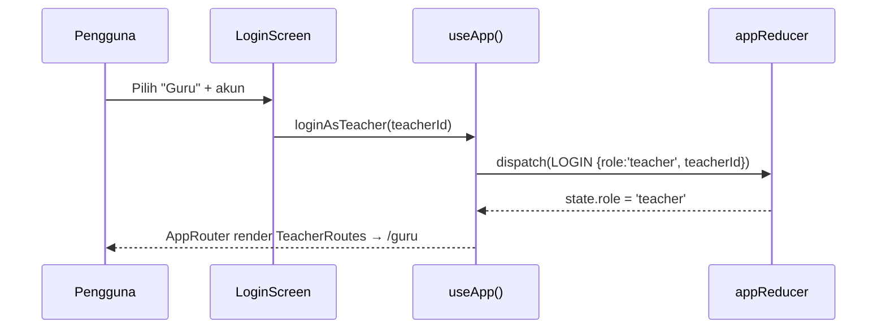
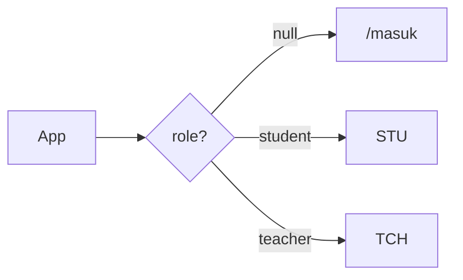
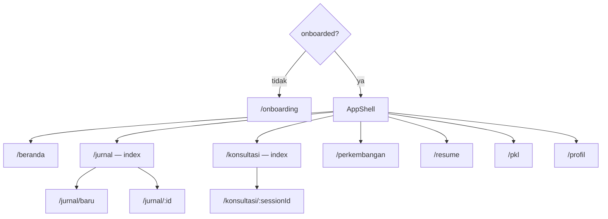

# Role & Routing

Aplikasi punya dua jenis pengguna (`UserRole`): **murid (`student`)** dan
**guru (`teacher`)**. Guru dibagi lagi ke beberapa `TeacherRole`. Dokumen ini
menjelaskan alur masuk, gating rute, cakupan data, dan cara menambah role/halaman.

## 1. Role Pengguna

| `TeacherRole` | Label | Cakupan murid | Fokus |
| --- | --- | --- | --- |
| `WALI_KELAS` | Wali Kelas | Sesuai `major` + `grade` guru | Review resume mingguan |
| `GURU_BK` | Guru BK | **Semua** murid | Eskalasi & alert risiko |
| `PEMBIMBING_PKL` | Pembimbing PKL | Murid dengan `pklStatus !== 'belum'` | Monitoring PKL |
| `KAPROG` | Kaprog | Sesuai `major` guru | Tren agregat per jurusan |
| `ADMIN` | Admin | **Semua** murid | Kelola data sekolah |

Meta tampilan (label, tagline, deskripsi, ikon) ada di
`src/config/teacherRoles.ts` → `TEACHER_ROLE_META` / `TEACHER_ROLE_LIST`.

Cakupan data diterapkan oleh `rosterForTeacher(state, teacher)` di
`src/lib/teacher.ts`. Murid aktif (`currentStudent`) tetap relevan untuk sesi
murid; guru selalu bekerja atas *roster*, bukan murid aktif.

## 2. Alur Masuk

Halaman login: [`src/screens/auth/LoginScreen.tsx`](../src/screens/auth/LoginScreen.tsx)
di rute **`/masuk`**. Pengguna memilih tab peran:

- **Murid** → `loginAsStudent()`.
- **Guru** → memilih salah satu akun guru, lalu `loginAsTeacher(teacherId)`.



Jika role masih `null`, `AppRoutes` menampilkan `AuthRoutes` (semua URL
dialihkan ke `/masuk`). `logout()` mengembalikan `role` menjadi `null` tanpa
menghapus data lain.

Akun guru default untuk demo: `DEFAULT_TEACHER_ID = 't-bk'` (Guru BK) — cakupan
seluruh murid + seluruh alert.

## 3. Peta Rute

`App.tsx` memilih pohon rute berdasarkan `state.hydrated` dan `state.role`.



### Rute murid (`StudentRoutes`)



Bila belum onboarding, hanya `/onboarding` yang aktif dan URL lain dialihkan ke
sana.

### Rute guru (`TeacherRoutes`)

Semua berada di dalam `TeacherShell`.

| Path | Halaman (screen) |
| --- | --- |
| `/guru` | `Dashboard/TeacherDashboard` |
| `/guru/review` | `ReviewResume/ReviewResumeScreen` |
| `/guru/alert` | `RiskAlerts/RiskAlertsScreen` |
| `/guru/murid` | `Students/StudentsScreen` |
| `/guru/pkl` | `Pkl/PklMonitoringScreen` |
| `/guru/pengaturan` | `Settings/TeacherSettingsScreen` |

URL tak dikenal dialihkan ke `/guru`. Navigasi didefinisikan di
`src/components/teacher/teacherNav.ts` (`TEACHER_NAV`), dengan `badgeKey`
opsional (`review`/`alert`) untuk menampilkan angka notifikasi.

> `/guru/pengaturan` **tidak** masuk `TEACHER_NAV` supaya bar bawah mobile tidak
> penuh. Halamannya diakses lewat ikon gear di sidebar/top bar/header mobile
> atau lewat command palette (`TeacherCommandPalette` → "Pengaturan guru").

## 4. Cakupan Data Guru (`src/lib/teacher.ts`)

| Fungsi | Kegunaan |
| --- | --- |
| `rosterForTeacher(state, teacher)` | Daftar murid sesuai role |
| `buildWeekSummary(studentId, state, offset)` | Ringkasan mingguan (jurnal, mood, target, chat) |
| `studentOverview(state, student)` | Ringkasan per murid (skor, streak, alert, review) |
| `overviewsFor(state, students)` | Peta overview untuk satu roster |
| `allRiskAlerts(state, students?)` | Semua alert dalam cakupan, terurut terbaru |
| `teacherStats(state, students)` | Statistik agregat untuk dasbor |

`PKL_STATUS_META` menyediakan label + tone untuk `PklStatus`.

## 5. Cara Menambah Role Guru Baru

1. Tambahkan nilai ke union `TeacherRole` di `src/types/index.ts`.
2. Tambahkan entri di `TEACHER_ROLE_META` dan `TEACHER_ROLE_LIST`
   (`src/config/teacherRoles.ts`).
3. Tambahkan akun contoh di `SEED_TEACHERS` (`src/data/teachers.ts`).
4. Tangani cakupan murid di `rosterForTeacher` (`src/lib/teacher.ts`).
5. Bila perlu, tampilkan perbedaan di layar guru terkait (dasbor, review, alert).

## 6. Cara Menambah Halaman Guru Baru

1. Buat screen di `src/screens/teacher/<Nama>/<Nama>Screen.tsx`.
2. Tambahkan impor **lazy** di `src/routes/TeacherRoutes.tsx` dan daftarkan
   `<Route path="/guru/..." element={...} />`.
3. Tambahkan item di `TEACHER_NAV` (`src/components/teacher/teacherNav.ts`),
   pilih `icon` dari registry `IconName`.
4. Gunakan `PageHeader` untuk judul/eyebrow dan primitif `ui/` agar konsisten.

Contoh lazy import:

```tsx
const NewScreen = lazy(() =>
  import('../screens/teacher/New/NewScreen').then((m) => ({
    default: m.NewScreen,
  })),
)
```

> Ingat aturan kedalaman impor: file di `src/screens/teacher/<X>/` memakai
> `../../../` untuk mencapai `components`, `lib`, `store`, dan `types`
> (lihat [`conventions.md`](conventions.md)).
