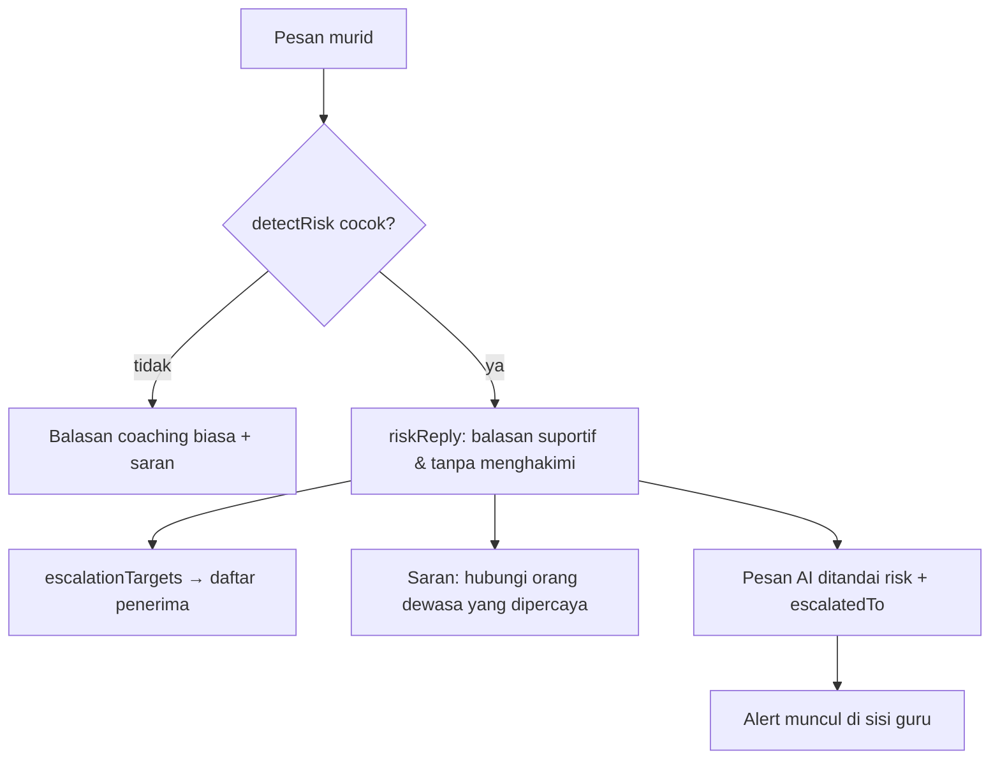

# Skoring & Deteksi Risiko

Dokumen ini menjelaskan cara aplikasi menghitung skor dimensi, streak, lencana,
serta bagaimana risiko terdeteksi dan dieskalasi. Semua logika ada di
`src/lib/scoring.ts` dan `src/lib/risk.ts` (murni, tanpa React).

## 1. Skor Dimensi

Setiap dimensi (baik PPP maupun Kesiapan Kerja) dihitung oleh `scoreGroup()`
di `src/lib/scoring.ts`.

```txt
mentions    = Σ recencyWeight(tanggal) untuk setiap jurnal yang menandai dimensi
targetBonus = Σ (target selesai ? 12 : progress × 0.06) untuk target di dimensi itu
chatBonus   = (grup WORK_READINESS) ? jumlah sesi PKL/KARIER × 1.5 : 0
score       = clamp(round(16 + mentions × 8.5 + targetBonus + chatBonus), 0, 100)
```

Keterangan:

- **`recencyWeight`** memberi bobot lebih pada jurnal terbaru:
  - ≤ 7 hari → **2**
  - ≤ 30 hari → **1.5**
  - lebih lama → **1**
- **`mentions`** yang ditampilkan UI = jumlah jurnal (bukan bobot) yang menandai
  dimensi tersebut.
- **Bonus target** mendorong penyelesaian target; target yang `selesai` memberi
  lompatan penuh (12), sedangkan yang masih aktif memberi kontribusi proporsional.
- **Bonus chat** hanya berlaku untuk grup Kesiapan Kerja, sebagai apresiasi atas
  refleksi seputar PKL/Karier.
- Semua nilai dijepit ke rentang 0–100 (`clamp`).

**Rata-rata grup** (`characterAverage`) = pembulatan rata-rata skor seluruh
dimensi dalam grup. Nilai inilah yang tampil sebagai "Karakter" dan
"Kesiapan Kerja" (`pppAverage`, `wrAverage` pada `derive()`).

## 2. Streak

`currentStreak(journals, studentId)` menghitung berapa hari berturut-turut
(hingga 60 hari ke belakang) murid menulis jurnal. Menulis jurnal **hari ini**
tidak wajib ada untuk mempertahankan streak — hari pertama yang kosong tidak
langsung memutus.

## 3. Lencana

`computeBadges()` memetakan kondisi ke id lencana; definisi tampilannya ada di
`src/config/badges.ts`.

| Id lencana | Nama | Syarat |
| --- | --- | --- |
| `mulai-tumbuh` | Mulai Tumbuh | ≥ 1 jurnal |
| `konsisten-7` | Konsisten 7 Hari | ≥ 7 hari berbeda |
| `refleksi-mendalam` | Refleksi Mendalam | ≥ 20 jurnal |
| `bintang-tim` | Bintang Kerja Tim | skor `gotong-royong` ≥ 75 |
| `siap-kerja` | Siap Kerja | semua dimensi Kesiapan Kerja ≥ 70 |
| `pejuang-pkl` | Pejuang PKL | ≥ 3 jurnal bertanda `pkl` |
| `pelayan-teladan` | Pelayan Teladan | skor `gotong-royong` ≥ 78 |
| `tenang-tekanan` | Tenang Saat Tekanan | skor `adaptasi` ≥ 78 |
| `teliti-detail` | Teliti Sampai Detail | skor `bernalar-kritis` ≥ 78 |
| `jujur-angka` | Jujur pada Angka | skor `etika-profesi` ≥ 78 |
| `pantang-menyerah` | Pantang Menyerah Debug | skor `adaptasi` ≥ 80 |
| `rekan-satu-tim` | Rekan Satu Tim | skor `komunikasi-tim` ≥ 80 |

`resumeHighlights()` mengambil judul dari beberapa jurnal terbaru untuk mengisi
sorotan pada resume mingguan.

## 4. Deteksi Risiko

Deteksi berbasis kata kunci: `detectRisk(text)` memeriksa apakah pesan memuat
salah satu `keywords` (case-insensitive). **Aturan pertama yang cocok menang** —
karena itu urutan aturan penting (kasus paling berbahaya diletakkan lebih awal).

| Kategori | Severity | Label | Contoh kata kunci |
| --- | --- | --- | --- |
| `self-harm` | tinggi | Keselamatan diri | menyakiti diri, ingin mati, bunuh diri, capek hidup |
| `krisis` | tinggi | Krisis emosional | putus asa, tidak ada harapan, serangan panik, tidak kuat lagi |
| `kekerasan` | tinggi | Kekerasan | dipukul, ditampar, dikeroyok, diancam, disiksa |
| `pkl-pelecehan` | tinggi | Perlakuan tidak pantas di tempat kerja | pelecehan, dilecehkan, disentuh, catcalling |
| `bullying` | sedang | Perundungan | dibully, dipalak, diejek terus, dikucilkan |
| `pkl-eksploitasi` | sedang | Dugaan eksploitasi di tempat PKL | tidak dibayar, lembur terus, tanpa uang saku, diperas |
| `pkl-keselamatan` | sedang | Keselamatan kerja | kecelakaan kerja, terluka, alat tidak aman, tanpa pengaman |
| `ekonomi` | sedang | Tekanan ekonomi | berhenti sekolah, tidak mampu bayar, biaya sekolah |
| `kecanduan` | sedang | Kecanduan gim atau media sosial | kecanduan game, main game terus, main hp terus |

> Daftar kata kunci penuh ada di `src/lib/risk.ts`. Untuk menambah pola,
> tambahkan kata kunci pada kategori yang sesuai — jangan mengurangi kata kunci
> pada kategori `tinggi` tanpa pertimbangan.

### Eskalasi

`escalationTargets(flag)` menentukan penerima:

```txt
kategori diawali "pkl-"  → ['Guru BK', 'Pembimbing PKL', 'Kaprog']
selain itu               → ['Guru BK']
```

`SUPPORT_CONTACTS` menyediakan daftar rujukan (Guru BK, pembimbing PKL/wali
kelas, orang tua, guru yang dipercaya) untuk ditampilkan sebagai bantuan.

### Alur respons & eskalasi



Balasan risiko dibuat oleh `riskReply()` di `src/lib/ai.ts`. Nada tetap
suportif, tidak menghakimi, dan mengarahkan ke bantuan nyata.

## 5. Menurunkan Alert di Sisi Guru

Alert guru tidak disimpan terpisah. `allRiskAlerts()` di `src/lib/teacher.ts`
menelusuri setiap sesi chat dan mengumpulkan pesan yang punya `risk`:

- **id alert** = `<sessionId>:<messageId>`
- **target** = `message.escalatedTo` bila ada, jika tidak diturunkan dari
  kategori (pola `pkl-*` seperti di atas).
- Alert diurutkan dari yang paling baru.

`teacherStats()` meringkas: total murid, jumlah menunggu review, alert aktif,
alert severity tinggi, PKL berjalan, serta rata-rata PPP & Kesiapan Kerja.

## 6. Batasan & Catatan Etika

- Deteksi **rule-based** (kata kunci), bukan model ML — bisa salah deteksi
  (false positive/negative). Gunakan sebagai pemantik, bukan keputusan akhir.
- Fitur ini menyentuh data sensitif. Konten alert sebaiknya hanya terlihat oleh
  role berwenang (Guru BK, Pembimbing PKL/Kaprog untuk konteks PKL), sesuai
  [`product-spec.md`](product-spec.md) dan [`roles-and-routing.md`](roles-and-routing.md).
- Kategori risiko dengan `severity: 'tinggi'` mengasumsikan tindak lanjut
  manusia segera; aplikasi tidak menggantikan pendampingan profesional.
